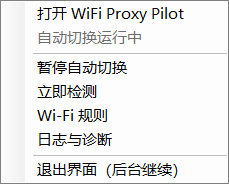

> **Documentation version: v3.2.0-beta.1.** This translated guide describes the older release. Current UI and installer documentation: [English](README.md), [简体中文](README.zh-CN.md), [v3.3 Setup EXE](https://github.com/jeffxuu/WiFiProxyPilot/releases/download/v3.3.0-beta.1/WiFiProxyPilot-Setup-x64.exe). The application UI supports en-US and zh-CN; README translation does not imply another UI language.

<div align="center">
  <h1>WiFi Proxy Pilot</h1>
  <h3>Windows 向けのスマートな Wi-Fi プロキシ切り替え</h3>
  <p>Wi-Fi の SSID、ゲートウェイのアドレス、ユーザー定義ルールに応じてシステムプロキシを自動で切り替える、軽量でモダンな Windows ユーティリティです。</p>

  
  
  
  [](https://github.com/jeffxuu/WiFiProxyPilot/releases)
  [](LICENSE)
  [](https://github.com/jeffxuu/WiFiProxyPilot/stargazers)
</div>

**[English](README.md) · [简体中文](README.zh-CN.md) · [繁體中文](README.zh-TW.md) · [日本語](README.ja.md) · [한국어](README.ko.md) · [Español](README.es.md) · [Français](README.fr.md) · [Deutsch](README.de.md) · [Português (Brasil)](README.pt-BR.md) · [Русский](README.ru.md) · [Tiếng Việt](README.vi.md)**

**Wi-Fi が変われば、プロキシも切り替わります。** 通常の Wi-Fi ではゲートウェイ上のプロキシを使い、指定したネットワークでは直接接続できます。モダンな WPF ウィンドウやシステムトレイから管理します。

> **v3.2.0-beta.1 は Beta/Prerelease です。** スクリーンショットは実際の WPF アプリに模擬ネットワークデータを表示したものです。実ネットワーク、ログイン・スリープ、インストール・アンインストールの受け入れ確認は、隔離環境での回帰テストとは別です。現在の UI は簡体字中国語のみで、README の翻訳は UI の多言語対応を意味しません。リポジトリは Public です。

## スクリーンショット


| Wi-Fi ルール | 設定 |
| --- | --- |
|  |  |



<details>
<summary>ダークテーマのプレビュー</summary>


</details>

画像はすべて隔離したテスト環境で実際のアプリを撮影したもので、**実際にプロキシへ接続できたことを示す証拠ではありません**。ダークテーマの画像は以前の Overview レイアウトです。トレイのメニューも隔離したアプリのテスト環境で模擬ネットワークデータを使って撮影しています。

## 主な機能

- 接続中の Wi-Fi を認識し、完全な SSID を大文字・小文字を区別せず照合します。
- 現在の物理 Wi-Fi インターフェイスの **IPv4 デフォルトゲートウェイ**を取得し、設定したプロキシポートを適用します。既定のポートは `7890` です。
- 選択したネットワークには直接接続ルールを使います。新規インストール時に**組み込みの Wi-Fi ルールはありません**。すべてのルールを編集・削除できます。
- macOS に着想を得た WPF UI、ライト・ダークテーマ、独立したバックグラウンド監視プロセスとシステムトレイを提供します。
- 自動管理、Windows の手動プロキシの状態、任意の TCP/HTTP 診断を区別します。プロキシが有効でもインターネット接続は保証されません。
- 設定をアトミックに保存し、「保存済み」と「監視プロセスによる適用済み」を区別します。
- 元のプロキシ設定のバックアップを保持し、ユーザーや別のアプリによる後の変更を保護します。
- MIT ライセンスのソースコードを公開対象として用意し、確認と貢献を可能にします。

## ダウンロードとインストール

**[v3.2.0-beta.1 をダウンロード — Beta/Prerelease](https://github.com/jeffxuu/WiFiProxyPilot/releases/tag/v3.2.0-beta.1)** · **[EXE](https://github.com/jeffxuu/WiFiProxyPilot/releases/download/v3.2.0-beta.1/WiFiProxySwitcher.exe)** · **[ZIP](https://github.com/jeffxuu/WiFiProxyPilot/releases/download/v3.2.0-beta.1/WiFiProxySwitcher.zip)** · **[SHA256](https://github.com/jeffxuu/WiFiProxyPilot/releases/download/v3.2.0-beta.1/SHA256.txt)** · **[ビルド成果物](https://github.com/jeffxuu/WiFiProxyPilot/actions/workflows/build.yml)**

v3.2.0-beta.1 は **Beta/Prerelease** であり、完全に安定した正式版ではありません。インストール前にバージョン、リリースノート、`SHA256.txt` のチェックサムを確認してください。Release バッジは Prerelease も含みます。GitHub のビルド成果物には保存期限があります。このバージョンのダウンロードには上記のリリースファイルを使ってください。

対象環境は **Windows 11 x64**、Windows PowerShell 5.1、WLAN サービス、Windows Script Host です。自己完結型 EXE のため .NET、Python、Node.js、WebView2 を別途インストールする必要はありません。他の Windows バージョンとの互換性は検証済みと主張していません。組織のポリシーによって WLAN 情報、プロキシ設定、タスクスケジューラが制限される場合があります。現在のビルドは未署名です。Windows のセキュリティ保護は有効にしておいてください。

EXE をダウンロードするか ZIP を展開し、同梱の `SHA256.txt` とハッシュを比較します。

```powershell
Get-FileHash .\WiFiProxySwitcher.exe -Algorithm SHA256
```

更新の互換性を保つため実行ファイル名は `WiFiProxySwitcher.exe` のままです。普段使っている対話型 Windows ユーザーとして起動してください。v3.2 のウィンドウを開くだけでは自動管理は有効になりません。別の管理者のアカウントを使って普段のアカウント向けにインストールしないでください。

## クイックスタートと初期設定

1. **ダウンロード**して、バージョンとハッシュを確認します。
2. **設定**で Wi-Fi ゲートウェイ上の既存プロキシのポートを指定し、直接接続したい Wi-Fi 名を追加します。
3. 管理対象の設定を確認してから、**自動切り替えを有効化**します。

**ゲートウェイでは実際にプロキシサービスが動作している必要があります。WiFi Proxy Pilot はプロキシサーバーや VPN ノードを提供しません。** Android のホットスポットでは現在の IPv4 ゲートウェイを自動で取得します。別のプロキシアプリの待ち受けポートを指定し、接続した Windows 端末からの通信を許可してください。ホットスポットだけではプロキシになりません。

## 動作の流れ

```text
Wi-Fi に接続 → 安定した SSID・インターフェイス情報を取得 → ルールを照合
  ├─ 直接接続ルールに一致 → Windows の手動プロキシを無効化
  └─ 一致するルールなし → 現在の Wi-Fi の IPv4 ゲートウェイを取得
                          → ゲートウェイ + 設定ポートを適用
```

監視プロセスは変更の直前に現在のネットワークを確認し、Wi-Fi 切り替え後に古いゲートウェイを再利用しないようにします。SSID が不明、経路がない、インターフェイスを一意に判断できない場合は既存設定を維持し、理由を示して再試行します。切断を確認した場合は手動プロキシを無効化します。PAC と自動検出の設定値は維持されるため、アプリの通信経路に引き続き影響することがあります。

## Wi-Fi ルールの管理

**Wi-Fi Rules** で追加、名前変更、削除、確実に認識できた現在のネットワークの追加を行えます。空の一覧も有効です。`OrdinalIgnoreCase` による名前全体の一致であり、前方一致や部分一致ではありません。許可された空白は保持します。SSID は UTF-8 で 1–32 バイトとし、制御文字は使えません。

**Save and Apply** は同時編集を確認してアトミックに保存します。「保存済み」はファイルへの書き込みを示します。「適用済み」には同じリビジョンの新しい互換性のある監視プロセスの heartbeat と、安定したネットワークが必要です。それ以外はバックグラウンドでの適用待ちを表示します。キャンセルは未保存の変更を破棄し、削除したルールを勝手に復元しません。

## システムトレイとプロキシモード

| 操作 | 動作 |
| --- | --- |
| 自動切り替えを有効化 | ネットワークを再取得し、ルールで手動プロキシを管理 |
| 一時停止 | 自動書き込みを停止し、現在のプロキシ設定を維持 |
| 直接接続 | 管理を一時停止し、Windows の手動プロキシだけを無効化 |
| 今すぐ確認 | 新しいネットワーク観測と安定した評価を要求 |
| ウィンドウを閉じる | 既定ではトレイへ隠し、監視プロセスは継続 |
| UI を終了 | GUI とトレイを閉じても、独立した監視プロセスは継続 |
| 元の設定を復元 | 管理を停止し、競合を確認してバックアップを復元 |

一時停止と直接接続の指定は GUI の再起動や Windows への再ログイン後も維持します。監視プロセスのログイン時起動とトレイの起動は別々に設定します。

**Strict** は選択したルールを適用し、診断失敗を報告してもプロキシを黙って無効にしません。**Safe** は指定回数の連続診断失敗後に直接接続へフォールバックでき、その場合、一部の通信がプロキシを経由しない可能性があります。不明な診断結果は回復とみなしません。TCP 診断はポートへ接続できることだけを確認します。HTTP 診断は設定した HTTP テスト URL へ実際にプロキシ経由で要求します。どちらも全サイト・全アプリの動作を保証しません。

## 復元とアンインストール

元の手動プロキシのバックアップは、インストール先の `state/proxy-before-install.json` です。更新ではこのバックアップとルールを保持し、新たな「元の設定」を作りません。設定変更時には以前の有効なファイルを保持します。これらのローカルファイルは非公開にしてください。

既存インストールの更新は新しい EXE を開き、**Settings → Advanced operations → Repair installation / Upgrade** を使います。先にアンインストールしたり、自分の設定をリポジトリの既定値で上書きしたりしないでください。[設定移行](docs/CONFIG_MIGRATION.md)も参照してください。

**Restore original configuration**、**Settings → Advanced operations → Uninstall**、または Windows の「インストールされているアプリ」を使います。復元・削除時には現在の値を元の値と本ツールの最終書き込み値と比較します。その後の外部変更は上書きせず、競合として表示します。強制復元は明示的な選択です。削除時に現在のプロキシを残すこともできます。削除対象は所有するタスク・起動登録と確認済み製品ファイルに限定し、無関係なファイルやユーザー変更済みファイルを保護します。直接接続モードでも元のバックアップは残ります。

## セキュリティとプライバシー

- SSID、プロキシ設定、状態、ログはローカルで処理し、クラウドアカウントや解析サービスは不要です。
- Wi-Fi のパスワードは収集しません。任意の診断では指定したプロキシと、HTTP モードでは設定した URL に接続します。
- 元のバックアップを保持します。インストールとタスク操作では現在のユーザーと権限確認を尊重します。
- 管理するのは現在の Windows ユーザーの**手動プロキシ**です。DNS、経路、ファイアウォールルールは変更しません。
- ログや診断にネットワーク識別情報が含まれる場合があります。共有前に確認して個人情報を伏せてください。

セキュリティ問題は [SECURITY.md](SECURITY.md) に従って報告してください。

## よくある質問

**Windows 11 で Wi-Fi ごとにプロキシを自動切り替えするには？** ゲートウェイのプロキシポートを設定し、直接接続用 SSID を追加して自動切り替えを有効化します。監視プロセスが安定した Wi-Fi 変更を評価し、現在のユーザーの手動プロキシを適用します。

**Android ホットスポットのゲートウェイを Windows プロキシに使うには？** 携帯電話で別のプロキシサービスを動かし、テザリング端末の接続を許可してポートを設定します。ゲートウェイは現在の Wi-Fi インターフェイスから取得します。接続できないときは携帯電話側のサービスとファイアウォールを確認してください。

**VPN は付属しますか？** 付属しません。サービスはユーザーが用意します。独自プロキシ設定を使うアプリや Windows の設定を参照しないアプリは異なる動作をする場合があります。

**プロキシが有効なのにインターネットへ接続できないのはなぜ？** ゲートウェイ上にプロキシがない、ポートが違う、サービスが停止している、宛先が応答しないなどが考えられます。TCP/HTTP 診断を別々に確認してください。一時停止は設定を維持し、直接接続は手動プロキシを無効化します。PAC は引き続き通信に影響する場合があります。

**特定の Wi-Fi でプロキシを使わないようにするには？** 完全な SSID を Wi-Fi Rules に追加して保存・適用します。すべて編集・削除可能で、空の一覧も有効です。

**Windows のプロキシ設定を元に戻すには？** 元の設定の復元を選び、外部変更との競合を確認します。直接接続は手動プロキシを無効にするだけで、元のサーバーや除外一覧は復元しません。

**ウィンドウを閉じても動き続けますか？** はい。X は既定でトレイへ隠します。GUI を終了しても独立した監視プロセスは継続します。バックグラウンド管理を変更するには一時停止または復元を使います。

**現在のネットワークを取得できないのはなぜ？** WLAN・位置情報の権限、組織ポリシー、経路欠落、監視プロセスの停止、古い heartbeat が原因になり得ます。UI は古い情報を現在の情報として扱わず、理由と最後の有効な観測を表示します。

**何をテストしていますか？** [v3.2 テスト結果](docs/TEST_RESULTS_V3_2.md)、[性能の根拠](docs/PERFORMANCE_V3_2.md)、[リリース確認表](docs/RELEASE_CHECKLIST.md)を参照してください。隔離環境のテストは実ネットワークやインストールの受け入れ確認ではなく、性能目標は測定結果ではありません。

## Star History

WiFi Proxy Pilot が作業を楽にしたら、プロジェクトへの Star をご検討ください。

<a href="https://star-history.com/#jeffxuu/WiFiProxyPilot&Date">
  <picture>
    <source media="(prefers-color-scheme: dark)" srcset="https://api.star-history.com/svg?repos=jeffxuu/WiFiProxyPilot&type=Date&theme=dark" />
    <source media="(prefers-color-scheme: light)" srcset="https://api.star-history.com/svg?repos=jeffxuu/WiFiProxyPilot&type=Date" />
    
  </picture>
</a>

公式のライブ SVG はこの公開リポジトリの実際の GitHub データを使います。2026-10-14 に確認した Star 数は 0 件なので、履歴が空なのは想定どおりです。確認時にはライト・ダーク両テーマの画像 URL が HTTP 200 を返しました。Star や成長を捏造しません。[公式の埋め込みガイド](https://www.star-history.com/blog/how-to-use-github-star-history/)も参照してください。

## 貢献とロードマップ

アクセス権を持つ方からの Issue と Pull Request を歓迎します。ビルド、期待した動作、実際の動作、個人情報を伏せた証拠を記載してください。Windows ビルドとレビュー手順は [CONTRIBUTING.md](CONTRIBUTING.md) にあります。個人設定、プロキシバックアップ、認証情報、未編集のログは添付しないでください。

計画中の作業は、実環境の更新・ログイン・スリープ・削除確認、残る WPF のアクセシビリティとレイアウト確認、起動性能の改善、UI のローカライズです。これらは実装済み機能ではありません。自動更新も未実装です。

`global.json` の SDK と Windows PowerShell でビルドします。

```powershell
powershell.exe -NoProfile -File tests\Run-Tests.ps1 -ResultPath artifacts\engine-results.json
powershell.exe -NoProfile -File release\Build.ps1
```

ビルドは自己完結型 `win-x64` EXE を生成し、インストールやホストのプロキシ変更は行いません。互換性のため既存の `WiFiProxySwitcher` のインストール、レジストリ、mutex、タスクの識別子を保持します。

## ライセンス

プロジェクトのソースコードは [MIT](LICENSE) ライセンスです。第三者の素材にはそれぞれの条件が適用されます。[第三者に関する通知](docs/THIRD_PARTY_NOTICES.md)を参照してください。Windows のシステムフォントを使い、フォントを再配布しません。
