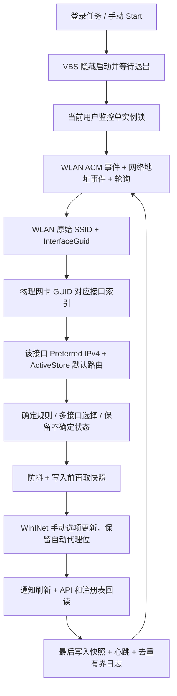

# 架构与可靠性说明

## 数据流与边界

`Core.ps1` 是纯规则和可跨平台测试的状态处理；`Windows.ps1` 负责平台采集、管理保护与诊断；`Native.cs` 在进程内编译并调用 Windows API，不产生外部 exe，不使用 netsh/ipconfig 文本。`Control.ps1` 通过 `Lifecycle.ps1` 管理本用户安装及任务；`Monitor.ps1` 是生产监控循环，测试直接注入其系统边界。`Diagnose.ps1` 只读检查，不调用代理写入或任务变更。完整源代码由安装入口复制，无远程执行。

WLAN 连接状态 1 才允许查询 SSID；4（断开）和 0（未就绪）没有有效连接；连接过程其他状态不是已确认断开。服务不可用或查询拒绝返回 Unknown，并在 WLAN 查询失败后重开句柄。非 UTF-8 SSID 保留原始字节身份，按非白名单处理。SSID 使用 DOT11_SSID 长度和字节，不采用配置文件名、接口描述、BSSID 或网络配置名称。

GUID 唯一对应适配器并排除虚拟接口，只使用 HardwareInterface=真、Up 的候选；IPv4 默认路由来自该接口 ActiveStore，排除 IPv6、无效/本机地址、过期及非 Alive 路由；要求接口连接、Preferred IPv4。每次采集重新读取，没有历史网关缓存。多 Wi-Fi 和多路由的明确成本规则见 README；未知数据返回 Keep。

## 状态一致性

网络事件只通知主循环，不在回调线程直接改代理；事件重复会合并。稳定确认使用单调 Stopwatch，等待不高速自旋。路由读取前后核对 WLAN 原始 SSID 与事件 Generation，应用前另取快照核对 SSID / GUID / 网关 / 地址身份 / 目标。变化时取消写入，下一轮重读。系统可能在任何两次调用之间发生变化，因此采用短窗口确认和持续纠正，不能承诺跨 API 的原子网络快照。

WinINet 查询 LAN（connection=NULL）的 FLAGS_UI、server、bypass、PAC；只设置 flags、server、bypass，保留 AUTO_PROXY_URL / AUTO_DETECT，不发送 PAC 设置选项。启用设置 DIRECT|PROXY，关闭移除 PROXY 而保留 DIRECT/自动位。调用 SETTINGS_CHANGED(39) 和 REFRESH(37)，再回读 API 和三个注册表值。关闭保留旧 server/bypass；开启保留已有 bypass 加 `<local>`。恢复支持原始值不存在的情况。

策略预检查阻止常见受管设置；未知管理软件干扰通过验证和日志呈现。API 成功不等于每个应用使用手动代理；自动代理优先级、应用缓存与自有代理必须实测。常驻监控会纠正手动值漂移，避免两个代理控制器并行使用。

## 生命周期与故障恢复

- `Global\WiFiProxySwitcher.<SID>.Watcher` 保护整个监控生命周期。重复进程直接退出 0。`Control` 互斥锁串行管理命令，弃置锁可安全接管。
- 停止先写停止标志，再禁用任务并等监控结束；超时仅终止拥有正确描述和身份的专属任务，再等锁。锁仍占用则拒绝恢复/删除。
- 异常进程退出向 VBS/任务传递失败；运行中可恢复异常限频记录和重试。任务 1 分钟重启策略负责真正崩溃，停止标志防止恢复/卸载过程中又写代理。
- 首次安装暂存后移动，升级完整预检在停止前执行；config 原始归属哈希保留，用户改过的脚本另存 user-backups。卸载写入持久化 Uninstalling 阶段，清理中断可从新包使用 -InstallDir 继续。
- 备份只创建一次；last-applied 仅成功验证后写。写入与记录之间崩溃时，不推测所有权，恢复冲突保护要求显式 Force。此保守行为防止覆盖人工修改。
- 默认只删清单内未被修改的文件；拒绝链接路径；未知文件和用户改动保留。任务和 HKCU 指针删除有所有权验证，不清理别的软件。
- 用户专用目录 ACL 保护脚本与备份。自定义目录需本地、专用、用户有权限；组策略造成无法创建任务/执行脚本属于外部条件，不自行提权或关闭防护。

## 模式与诊断

Strict 的写入先于诊断，故障只记录。Safe 的诊断结果按当前链路缓存，链路变更清零；诊断结束再核对链路，避免把 A 的结果用于 B。连续失败达到配置阈值才关闭，持续检测；TCP 和 HTTP 的结果严格区分。HTTP 测试采用有限缓冲和总状态行期限，认证/凭据不发送，不把远端 5xx 误认作代理服务故障。

## Microsoft 官方依据

实现时阅读了以下 MicrosoftDocs 官方源文档；这些链接可用于实机排查：

- [设置和读取 Internet Options](https://learn.microsoft.com/en-us/windows/win32/wininet/setting-and-retrieving-internet-options)：LAN connection=NULL、per-connection option list、查询分配字符串用 GlobalFree。
- [INTERNET_PER_CONN_OPTIONW](https://learn.microsoft.com/en-us/windows/win32/api/wininet/ns-wininet-internet_per_conn_optionw)：Windows 7+ 推荐 FLAGS_UI 查询，用 FLAGS 设置/恢复；不删除自动代理标志。
- [WlanQueryInterface](https://learn.microsoft.com/en-us/windows/win32/api/wlanapi/nf-wlanapi-wlanqueryinterface)：current_connection 返回连接属性与真实 DOT11_SSID。
- [Wi-Fi API 与位置权限行为变更](https://learn.microsoft.com/en-us/windows/win32/nativewifi/wi-fi-access-location-changes)：Windows 11 新版本位置权限影响 current_connection 查询与 MSM 通知；本工具只订阅 ACM，仍必须处理 SSID 访问拒绝。

对真实 ABI、组策略生效、当前用户任务行为、无窗口体验与长期运行的结论必须来自 Windows 验收，而不是上述文档或 Linux 编译结果。

第二轮逐项修复与 Windows 未验证事项见 [REVIEW_ROUND2.md](REVIEW_ROUND2.md)。
