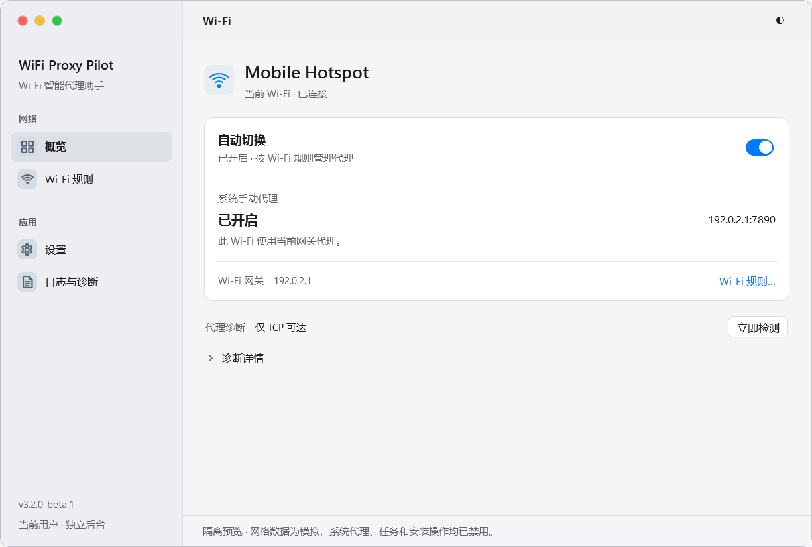
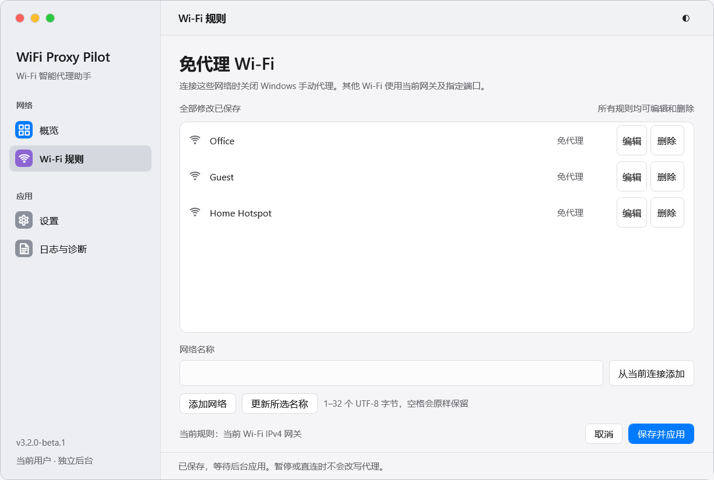
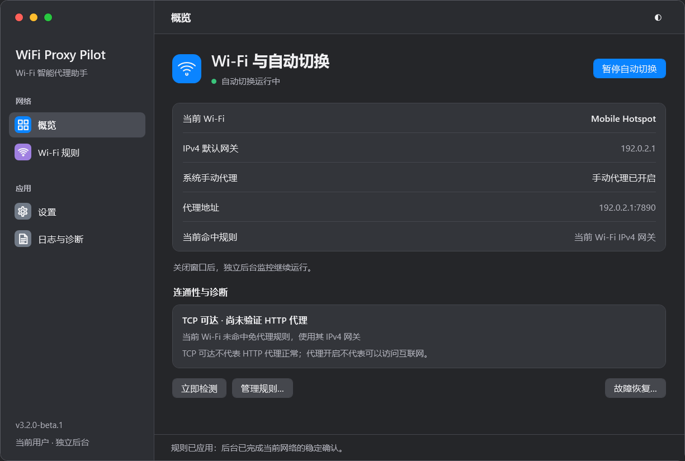
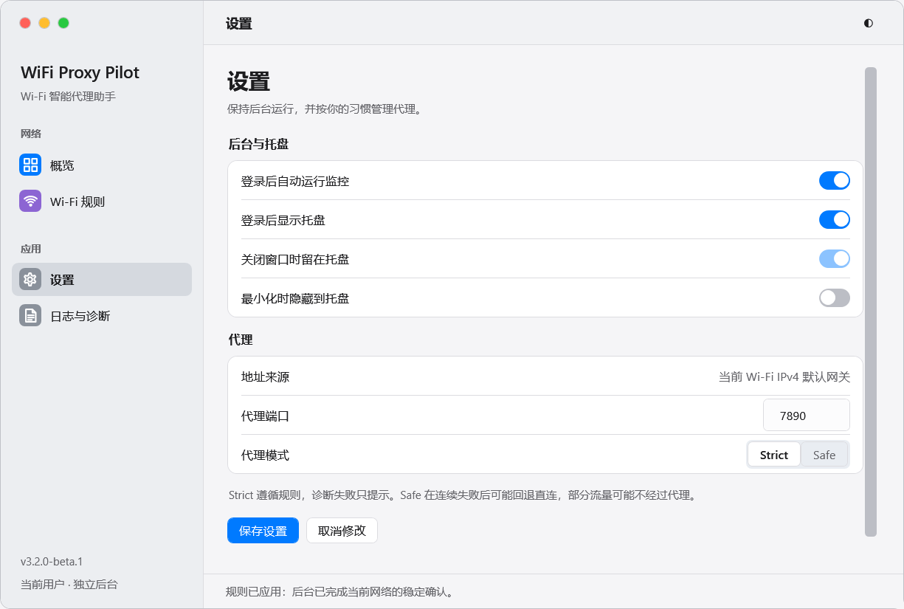

# macOS-inspired WPF visual prototype

2026-10-14 · Design review checkpoint, before final release.

## Implemented stack

.NET SDK 8.0.425, .NET/WPF 8.0.31, net8.0-windows, C# MVVM. No third-party UI runtime, Electron, WebView2, Apple fonts, SF Symbols, or Apple artwork. WPF UI 4.3.0 was evaluated for .NET 8 compatibility; its default Fluent dictionaries and fonts are not referenced by the project. WinForms NotifyIcon remains the tray adapter and existing single-instance events remain the activation mechanism.

## References and interpretation

[Designing for macOS](https://developer.apple.com/design/human-interface-guidelines/designing-for-macos/) informed compact density, fewer nested destinations and keyboard/window support. [Sidebars](https://developer.apple.com/design/human-interface-guidelines/sidebars) informed top-level navigation with a clear selected row. [Materials](https://developer.apple.com/design/human-interface-guidelines/materials) informed separating navigation/toolbar surfaces from content; content groups remain opaque and legible. These are project interpretations, not copied assets.

The prototype uses a 980×660 DIP window, 220 DIP sidebar, 48 DIP toolbar, 42 DIP information rows, 36 DIP navigation rows and 28 DIP minimum buttons. Page headings are 22–23 DIP, body text 13 DIP and supporting text 12 DIP. Segoe UI Variable/Segoe UI and Windows-installed Chinese fallback fonts are requested; no font files are distributed.

## Files and controls

| File | Responsibility |
| --- | --- |
| src/WiFiProxySwitcher/Wpf/Tokens.Light.xaml | Independent light palette |
| Tokens.Dark.xaml | Independent dark palette, not inverted colors |
| Tokens.HighContrast.xaml | Windows high-contrast system colors |
| Theme.xaml | Buttons, inputs, navigation rows, segmented choices, switches, lists, menus, tooltips, scrollbar and expander templates; original vector paths |
| MainWindow.xaml / .xaml.cs | WindowChrome, traffic-light controls, toolbar, cached lazy pages, theme application and presentation-only handlers |
| DashboardView.xaml | Current SSID header; automatic switch, observed proxy/address/reason, gateway/rules footer; compact diagnostics with collapsed details |
| RulesView.xaml | Editable/deletable user rules, empty state, current-network addition and draft controls |
| SettingsView.xaml | Complete background/tray and proxy groups, switches and Strict/Safe segments |
| ViewModels.cs | Commands and bindings; ConfigurationApplication confirmation, no registry/process/task logic |
| ApplicationServices.cs | Existing controller/configuration/status integration |
| PilotTrayHost.cs | Tray and OS/session event lifetime; no watcher-stop on UI exit |

Hover, pressed, keyboard focus and disabled states are defined in templates. Page transitions use a 140ms opacity animation only when Windows client-area animations are enabled; preview/measurement disables it to avoid hiding layout timings. Noncurrent pages are instantiated on demand and reused. Status/configuration/cache work runs on worker threads; logs load only on the log page, with the existing 64 KiB/100-event bound.

## Structure change

| v3.1 | This prototype |
| --- | --- |
| WinForms four-page control tree created eagerly | WPF shell plus lazy views |
| Six equal overview tiles | One settings group with automatic switch and observed proxy, compact diagnostics |
| Protected built-in rows | All rules editable/deletable, valid empty list |
| Checkbox-heavy settings | Group rows, switches, segmented Strict/Safe |
| Window-driven business actions | View models call application services and the existing engine |

Legacy WinForms source remains in Git and is excluded from the formal GUI build. The EXE has one user-facing GUI route. The independent PowerShell engine, installation identity, paths, backup and task/mutex ownership remain compatible.

## Real rendering evidence

Captured from the running WPF visual tree on Windows 11 at 125% DPI (1225×825 physical pixels). Network names and 192.0.2.1 are synthetic fixtures. These images are not generated concepts and are not real-network acceptance evidence.

## Preview

Run `powershell.exe -NoProfile -ExecutionPolicy Bypass -File tools/Preview.ps1` after building. `/preview /output <owned-directory>/preview.json` uses an isolated configuration, a separate single-instance namespace and prohibits real proxy/task/install writes. It can coexist with the installed v3.0/v3.1 application. Closing hides it; its tray menu exits only the preview GUI.

Build: `powershell.exe -NoProfile -ExecutionPolicy Bypass -File release/Build.ps1 -Dotnet <dotnet.exe>`. The self-contained EXE is `release/dist/WiFiProxySwitcher.exe`; this filename preserves upgrade identity while the displayed product is WiFi Proxy Pilot.

## Approximation and open work

Navigation and toolbar layering, compact proportions, window controls and colors approximate macOS. There is no AppKit/SwiftUI Liquid Glass implementation, refraction or live glass reflection; sidebar layering currently uses inexpensive opaque colors. Windows DWM corner preferences are requested; OS shadow, real dragging, resize/Snap layouts, Alt+F4, multi-monitor DPI and high-contrast interaction still need manual acceptance. Maximize hit testing exposes HTMAXBUTTON to Windows, but Snap hover has not been manually certified.

Custom in-window confirmation sheets, colored log rows/raw JSON detail, final accessibility tuning and remaining page polish follow visual approval. Startup remains over budget; see PERFORMANCE_V3_2.md. This checkpoint is not a release-ready claim.

## Homepage refinement after design feedback

The user requested a second refinement rather than propagating the first design. Only the light homepage and necessary shared tokens/navigation/window presentation have been polished at this checkpoint. The toolbar reads Wi-Fi, the page header is the actual network name, and a labeled automatic-management switch replaces the large action button. Proxy enabled/disabled state has greater weight than supporting labels; the address remains clear on the right, with its reason below. Gateway and the rules link are secondary. The always-visible fault-recovery action was removed; technical TCP/HTTP distinctions remain in collapsed diagnostic details. Sidebar icon blocks are neutral instead of highly saturated.

The current light overview image above is this refinement. Rules, settings and dark-overview images are from the earlier prototype; their page refinements wait for visual confirmation. Four targeted homepage checks passed: independent state/diagnostic display, actual native maximize/restore plus keyboard focus, actual light rendering and isolated switch failure without invented success. This does not certify real dragging, Snap hover or multi-monitor DPI. No PowerShell engine change was made for the visual refinement.
